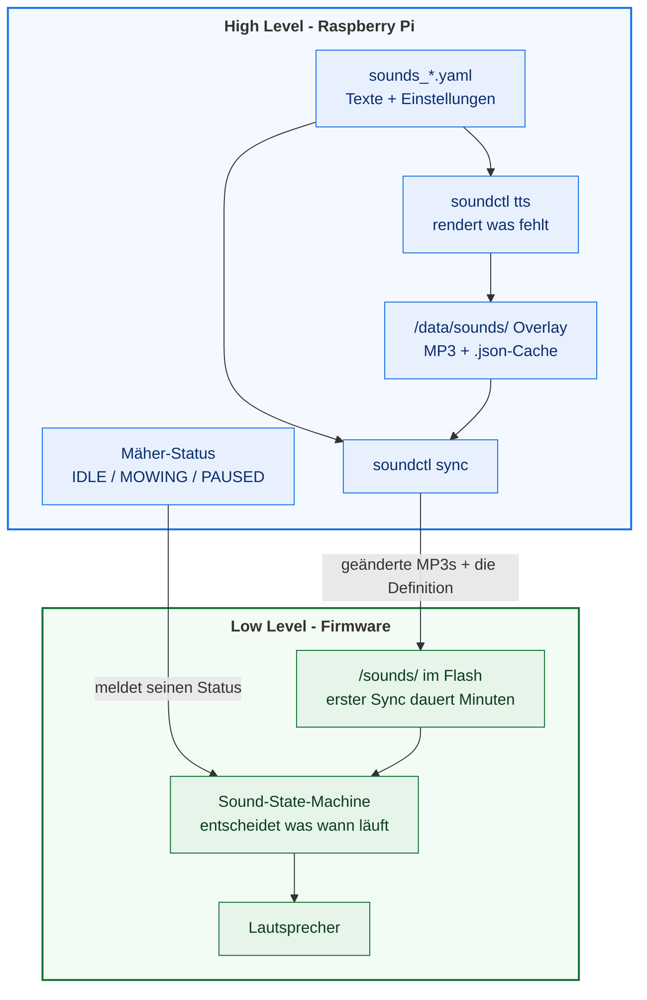

## Übersicht

Ein v2-OpenMower kann Töne, Notenfolgen und MP3-Dateien abspielen - entweder eine
Aufnahme oder einen Satz, den eine gehostete Text-to-Speech-Engine spricht. Was wann
erklingt, steht in einer Definitionsdatei, die im Image mitgeliefert wird
(`sounds_*.yaml`, eine pro Sprache). Die Ansagen sind bereits gesprochen und liegen dem
Image bei; der Roboter schiebt sie beim Start zum Low Level - von Hand vorbereiten musst
du nichts.

Standardmäßig ist das System **abgeschaltet**: ein Parameter schaltet es ein (siehe
[Schritt 1](#schritt-1-den-sound-service-aktivieren)).

## Voraussetzungen

Das Soundsystem braucht einen **Verstärker** und einen **Lautsprecher**.
Der Verstärker ist bei den YardForce- und SABO-Boards an Bord.
Das Universal-Board kommt ohne daher und wird deshalb **nicht** unterstützt!

Den Lautsprecher baust du selbst ein. Er sitzt in einem kleinen Gehäuse, und ein
"offizielles" gibt es nicht: die Community hat mehrere 3D-druckbare Designs
veröffentlicht, gesammelt unter der
[Suche nach "openmower speaker" auf Printables](https://www.printables.com/search/models?ctx=models&q=openmower+speaker).

Die Gehäuse sind für die verschiedenen Mäher-Modelle gemacht, nicht für eine bestimmte
Board-Revision - prüfe vor dem Druck, für welches Modell ein Design gedacht ist. Unter
v1 wurde oft ein 2W/8Ω Lautsprecher verbaut; für v2 sollte es mindestens **&ge; 3W bei 4Ω** sein.

## So funktioniert es

Das Image liefert eine Definition pro Sprache mit (`sounds_*.yaml`). Eine Definition
listet die Ereignisse, die der Mäher ansagen kann - `EMERGENCY`, `MOWING_START`,
`LOW_BATTERY` und so weiter - und dazu jeweils entweder eine fertige MP3 oder den zu
sprechenden Text. Welcher Ton, wie laut, welche Aufnahme: all das steht dort.



* **`soundctl tts`** schickt nur die Texte an die TTS-Engine, deren Render fehlt oder
  veraltet ist, und kodiert das Ergebnis als 16-kHz-Mono-MP3. Die Images kommen mit
  fertig gerenderten Ansagen, deshalb ist das ein No-op, solange kein Text geändert
  wurde - und genau das ist der einzige Fall, der einen API-Key braucht (siehe
  [Eigene Sounds](#eigene-sounds)).
* **`soundctl sync`** lädt die MP3-Dateien hoch, die die Definition referenziert, und
  schiebt die Definition selbst zum Low Level. Dateien mit gleichem Inhalt werden
  übersprungen.
* **Der Upload ist nicht schnell.** Das Low Level schreibt die Dateien in 256-Byte-
  Blöcken in seinen eigenen Flash, über dieselbe Verbindung, die es auch für alles
  andere nutzt - ein erster Sync des ganzen Satzes kann deshalb mehrere Minuten dauern.
  Spätere Syncs schicken nur geänderte Dateien.
* **Das High Level spielt nichts von sich aus ab.** Im Normalbetrieb meldet es den
  Zustand des Mähers, und die Sound-State-Machine im Low Level entscheidet, welcher
  Sound dazu gehört und wann er läuft. Um einen Sound von Hand auszulösen - zum Testen,
  nicht für den Normalbetrieb - siehe [Schritt 2](#schritt-2-prüfen-ob-es-funktioniert).
* Beide Befehle laufen bei jedem Start und bei jedem Reconnect zum Low Level, eine
  geänderte Definition erreicht den Mäher also ohne manuellen Schritt.

## Schritt 1: Den Sound-Service aktivieren

Öffne die ROS-Konfiguration:

```bash
openmower configure ros
```

Setze `enabled` auf `true` und (wenn du willst) eine Master-Lautstärke:

```yaml
ll:
  services:
    sound:
      # Master Volume: -1 = keep LL stored volume, 0-100 = override on HL start
      volume: -1
      #
      # HW v2 only
      #
      # Set to true on boards with a sound amplifier/speaker, will call `soundctl sync` on startup
      enabled: true
      # Currently available sound languages: en, de, fr, nl, pl, sv.
      config_file: "/opt/open_mower_ros/src/open_mower/params/sounds_en.yaml"
      #
      # HW v1 only
      #
      language: "en"
```

| Parameter     | Bedeutung                                                                                                                                                                                                                                       |
| ------------- | ----------------------------------------------------------------------------------------------------------------------------------------------------------------------------------------------------------------------------------------------- |
| `enabled`     | Schaltet das Soundsystem für diesen Mäher ein. `false` (der Standard) lässt das Low Level still und überspringt den Sync beim Start.                                                                                                            |
| `config_file` | Die zu verwendende Definition, **nur v2**. Zeig sie auf die Datei der gewünschten Sprache (en, de, fr, nl, pl oder sv). Eine Kopie in `/data/sounds/` funktioniert auch (und übersteht ein Image-Update, solange dieses Overlay gemountet ist). |
| `volume`      | `-1` behält die Lautstärke, die das Low Level gespeichert hat; `0`..`100` setzt sie bei jedem Start.                                                                                                                                            |
| `language`    | Wird nur von **v1**-Hardware genutzt. Lass den Wert stehen; auf v2 entscheidet `config_file`.                                                                                                                                                   |

{}
Die mitgelieferten Definitionen liegen im Image unter
`/opt/open_mower_ros/src/open_mower/params/`. Lass `config_file` dorthin zeigen, außer
du willst eine eigene Kopie - siehe [Eigene Sounds](#eigene-sounds).
{}

Speichern genügt: erkennt `openmower configure ros` eine Änderung, startet es OpenMower
selbst neu. Beim nächsten Verbindungsaufbau zum Low Level synct der Roboter dann alle
fehlenden Ansagen in dessen Flash.

## Schritt 2: Prüfen, ob es funktioniert

Öffne eine Shell auf dem Mäher und löse direkt einen Sound aus:

```bash
openmower shell
soundctl sync
soundctl play sound EMERGENCY
soundctl play tone 1000 500
soundctl stop
```

`sync` ist derselbe Schritt, den der Start von sich aus macht; von Hand ausgeführt
sparst du dir den Neustart nach einer Änderung. `play sound` löst einen konfigurierten
Sound über seinen Namen aus, `play tone` einen synthetisierten (hier 1000 Hz für
500 ms), und `stop` beendet die Wiedergabe. `soundctl` ist im Image installiert.
Wenn nichts zu hören ist: `soundctl discover` listet die Dienste, die das Low Level
annonciert - der erste Blick, wenn der Sync das Board nicht erreicht.
`soundctl validate --check-mp3` prüft die Definition und die Audiodateien, und
`soundctl tts --check` meldet Ansagen, die noch fehlen.

## Eigene Sounds

Zwei Dinge solltest du wissen, bevor du eine Definition änderst:

* **Deine eigenen Aufnahmen und der TTS-API-Key gehören nach `/data/sounds/`**, nicht
  ins Image. Der Key ist das, was den Roboter *deine* Texte mit *deiner* Stimme rendern
  lässt - die mitgelieferten Ansagen sind bereits gerendert, du brauchst ihn also erst,
  wenn du eine davon änderst. Auf einem Serienmäher ist dieses Verzeichnis *nicht*
  persistent - es lebt im Container und ist nach einem Neustart weg. Mounte es vom Host,
  wenn du deine Dateien und den Key behalten willst. Der Kopf jeder `sounds_*.yaml` zeigt
  die genauen Schritte.
* **Ein geänderter Text rendert nur diese eine Datei neu.** Jeder Render schreibt eine
  kleine `.json` neben die MP3, die Text, Stimme und Einstellungen festhält; der Sync
  weigert sich, eine Datei hochzuladen, deren Text nicht mehr zur Definition passt.

Die vollständige Referenz - jede Sound-ID, das Format der Definition, die Varianten, die
beiden TTS-Engines und das Kommandozeilenwerkzeug - steht in
[`sounds/README.md`](https://github.com/ClemensElflein/open_mower_ros/blob/main/sounds/README.md)
und [`utils/soundctl/README.md`](https://github.com/ClemensElflein/open_mower_ros/blob/main/utils/soundctl/README.md).
