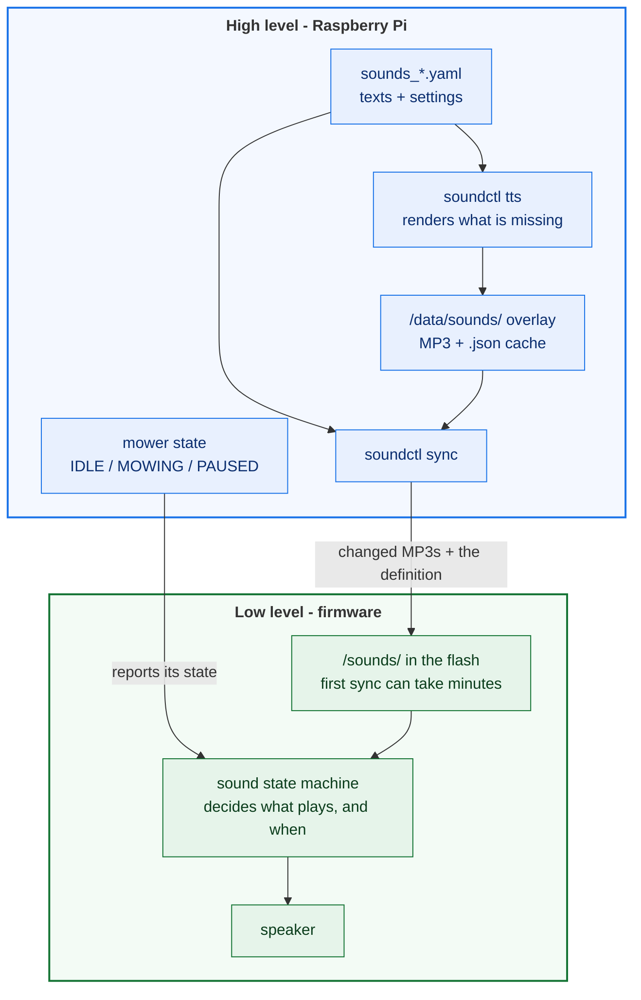

## Overview

A v2 OpenMower can play tones, note sequences and MP3 files - either a recording or
a sentence spoken by a hosted text-to-speech engine. What is played, and when, comes
from a definition file that ships with the image (`sounds_*.yaml`, one per language).
The announcements are already spoken and ship with the image; the robot only pushes
them to the low level at startup, so nothing has to be prepared by hand.

It is **disabled by default**: one parameter turns it on (see
[Step 1](#step-1-enable-the-sound-service)).

## Requirements

The sound system needs an **amplifier** and a **speaker**.
The amplifier is part of the YardForce- and SABO- boards.
The Universal board ships without one, so it is **not** supported!

You only add the speaker yourself. It sits in a small enclosure, and there is no
"official" one: the community has published several 3D-printable designs, collected
under the
["openmower speaker" search on Printables](https://www.printables.com/search/models?ctx=models&q=openmower+speaker).

The designs are made for the different mower models, not for a specific board
revision - check which model a design is for before printing. Under v1 a 2W/8Ω
speaker was common; for v2 it should be at least **&ge; 3W at 4Ω**.

## How it works

The image ships one definition per language (`sounds_*.yaml`). A definition lists the
events the mower can announce - `EMERGENCY`, `MOWING_START`, `LOW_BATTERY` and so on -
and for each one either a ready MP3 or the text to speak. Which tone, how loud, which
take: all of it is described there.



* **`soundctl tts`** sends only the texts whose render is missing or out of date to
  the TTS engine, and encodes the result as a 16 kHz mono MP3. The images ship with
  pre-rendered announcements, so this is a no-op unless a text changed - which is the
  only case that needs an API key (see [Custom sounds](#custom-sounds)).
* **`soundctl sync`** uploads the MP3 files the definition references and pushes the
  definition itself to the low level. Files whose content already matches are
  skipped.
* **The upload is not fast.** The low level writes the files into its own flash in
  256-byte chunks over the same link it uses for everything else, so a first sync of
  the whole set can take several minutes. Later syncs only send changed files.
* **The high level does not play anything on its own.** During normal operation it
  reports the mower's state, and the low level's sound state machine decides which
  sound that implies and when to play it. To trigger a sound by hand - for a test,
  not for normal operation - see [Step 2](#step-2-check-that-it-works).
* Both commands run on every start and every reconnect to the low level, so an updated
  definition reaches the mower without any manual step.

## Step 1: Enable the sound service

Open the ros configuration:

```bash
openmower configure ros
```

Set `enabled` to `true` and (if you want) a master volume:

```yaml
ll:
  services:
    sound:
      # Master Volume: -1 = keep LL stored volume, 0-100 = override on HL start
      volume: -1
      #
      # HW v2 only
      #
      # Set to true on boards with a sound amplifier/speaker, will call `soundctl sync` on startup
      enabled: true
      # Currently available sound languages: en, de, fr, nl, pl, sv.
      config_file: "/opt/open_mower_ros/src/open_mower/params/sounds_en.yaml"
      #
      # HW v1 only
      #
      language: "en"
```

| Parameter     | Meaning                                                                                                                                                                                                                                     |
| ------------- | ------------------------------------------------------------------------------------------------------------------------------------------------------------------------------------------------------------------------------------------- |
| `enabled`     | Turns the sound system on for this mower. `false` (the default) leaves the low level silent and skips the startup sync.                                                                                                                     |
| `config_file` | The definition to use, **v2 only**. Point it at the file of the language you want - `en`, `de`, `fr`, `nl`, `pl` or `sv`. A copy you keep in `/data/sounds/` also works (and survives an image update, as long as that overlay is mounted). |
| `volume`      | `-1` keeps the volume the low level has stored; `0`..`100` sets it on every start.                                                                                                                                                          |
| `language`    | Only used by **v1** hardware. Leave it as it is; `config_file` decides on v2.                                                                                                                                                               |

{}
The shipped definitions are inside the image at
`/opt/open_mower_ros/src/open_mower/params/`. Keep `config_file` pointing there unless
you want your own copy - see [Custom sounds](#custom-sounds).
{}

Saving is all it takes: when `openmower configure ros` detects a change, it restarts
OpenMower itself. On the next connect to the low level the robot then syncs every
missing announcement into the board's flash.

## Step 2: Check that it works

Open a shell on the mower and trigger a sound directly:

```bash
openmower shell
soundctl sync
soundctl play sound EMERGENCY
soundctl play tone 1000 500
soundctl stop
```

`sync` is the same step the startup does on its own; running it by hand saves you the
restart after a change. `play sound` triggers a configured sound by its name,
`play tone` a synthesised one (1000 Hz for 500 ms here), and `stop` ends playback.
`soundctl` is installed in the image. If nothing is heard, `soundctl discover` lists
the services the low level advertises - the first thing to look at when the sync
cannot reach the board. `soundctl validate --check-mp3` checks the definition and the
audio files, `soundctl tts --check` reports announcements that are still missing.

## Custom sounds

Two things are worth knowing before changing a definition:

* **Your own recordings and the TTS API key belong in `/data/sounds/`**, not in the
  image. The key is what lets the robot render *your* texts with *your* voice - the
  shipped announcements are already rendered, so nothing needs it until you change
  one. On a stock mower that directory is *not* persistent - it lives inside the
  container and is gone after a restart. Mount it from the host if you want to keep
  your files and the key. The header of any `sounds_*.yaml` shows the exact steps.
* **A changed text only re-renders that one file.** Every render writes a small
  `.json` next to the MP3 that records the text, the voice and the settings; the sync
  refuses to upload a file whose text no longer matches the definition.

The complete reference - every sound id, the definition format, the variants, the
two TTS engines and the command line tool - is in
[`sounds/README.md`](https://github.com/ClemensElflein/open_mower_ros/blob/main/sounds/README.md)
and [`utils/soundctl/README.md`](https://github.com/ClemensElflein/open_mower_ros/blob/main/utils/soundctl/README.md).
